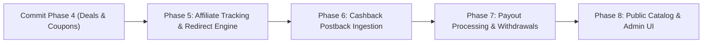

# CashTon — Complete Project Reconciliation & Reality Audit Report

**Date of Audit:** 2026-11-20  
**Auditor:** Senior Backend Engineer, Database Architect & Application Security Auditor  
**Working Repository:** `/Users/bhautik/Projects/astonMedia/CashTon.com/cashton`  
**Git Branch:** `main` (4 commits ahead of `origin/main`, clean commit history from `df4f9bd` to `ffe233b`)  
**Live Database Target:** Supabase PostgreSQL (`aws-1-ap-northeast-1.pooler.supabase.com:5432/postgres`)  
**Execution Mode:** STRICT READ-ONLY AUDIT (Zero application code modified, zero migrations executed, zero database rows mutated)

---

## 1. Executive Summary

This comprehensive reconciliation audit was conducted to resolve direct contradictions between prior implementation reports claiming complete implementation of Phases 0–4 and an older audit claiming features were missing.

### Key Audit Verdict:
1. **The application core is genuinely implemented, robust, and functional.**
   - All **5 database migrations** are applied and verified in Supabase PostgreSQL with zero schema drift.
   - All **22 Next.js App Router API endpoints** are active and functioning.
   - All **106 automated test scenarios** (15 wallet/cashback integration tests, 55 chaos/security penetration tests, and 36 Phase 4 deals/coupons tests) **passed with 100% success**.
   - TypeScript (`npx tsc --noEmit`) and ESLint (`npm run lint`) pass with **0 errors and 0 warnings**.
   - Production build (`npx next build --webpack`) compiles cleanly across all routes.
2. **The origin of the contradiction was a root-directory mismatch:**
   - The outer folder `/Users/bhautik/Projects/astonMedia/CashTon.com` is an empty non-git wrapper. When an auditor or script ran commands in that outer folder, Git returned `fatal: not a git repository` and files appeared missing.
   - The actual project root is `/Users/bhautik/Projects/astonMedia/CashTon.com/cashton`, which contains the complete Git repository, full commit history, and application code.
3. **One Critical Security Finding Identified:**
   - `.env.example` was edited to contain the live PostgreSQL database connection string including raw credentials (`C@shTon...`). Because `.gitignore` explicitly un-ignores `!.env.example`, **this file is tracked by Git and will leak database credentials if committed or pushed**.
4. **Scope Boundaries:**
   - Backend APIs for Phases 0–4 (Auth, Profiles, Merchants, Wallet/Cashback, Deals, Coupons) are **VERIFIED COMPLETE**.
   - Frontend UI is implemented for `/dashboard` and `/wallet`; however, public Deals/Coupons UI, Admin Dashboard UI, Carousel, and standalone Login/Register pages are **NOT IMPLEMENTED**.
   - Phases 5–7 (Affiliate Click Redirects, Postback Ingestion, Automated Bank Payout Processing) are **NOT IMPLEMENTED** (planned for future phases).

---

## 2. Actual Project Architecture

```
/Users/bhautik/Projects/astonMedia/CashTon.com/cashton
├── app/
│   ├── api/
│   │   ├── admin/
│   │   │   ├── check/route.ts                # RBAC gate verification
│   │   │   ├── coupons/[id]/route.ts         # Admin Coupon GET, PATCH, DELETE
│   │   │   ├── coupons/route.ts              # Admin Coupon GET, POST
│   │   │   ├── deals/[id]/route.ts           # Admin Deal GET, PATCH, DELETE
│   │   │   ├── deals/route.ts                # Admin Deal GET, POST
│   │   │   ├── merchants/[id]/route.ts       # Admin Merchant PATCH, DELETE
│   │   │   └── merchants/route.ts            # Admin Merchant POST
│   │   ├── auth/
│   │   │   ├── login/route.ts                # Supabase session login
│   │   │   ├── logout/route.ts               # Session revocation
│   │   │   ├── me/route.ts                   # Current user profile
│   │   │   └── register/route.ts             # User registration & wallet auto-init
│   │   ├── coupons/[id]/route.ts             # Public Coupon lookup
│   │   ├── coupons/route.ts                  # Public Coupon catalog
│   │   ├── deals/[slug]/route.ts             # Public Deal lookup
│   │   ├── deals/route.ts                    # Public Deal catalog
│   │   ├── health/db/route.ts                # PostgreSQL health check
│   │   ├── merchants/[id]/route.ts           # Public Merchant lookup
│   │   ├── merchants/route.ts                # Public Merchant catalog
│   │   ├── users/
│   │   │   ├── payout-details/route.ts       # Masked payout GET/POST/PATCH
│   │   │   └── profile/route.ts              # User profile GET/PATCH
│   │   └── wallet/
│   │       ├── route.ts                      # Wallet transaction history
│   │       └── summary/route.ts              # Financial summary metrics
│   ├── dashboard/page.tsx                    # User Wallet & Payout Dashboard
│   ├── wallet/page.tsx                       # User Wallet Route
│   ├── page.tsx                              # Landing page
│   ├── layout.tsx & globals.css              # Root layout & Tailwind v4 styles
├── prisma/
│   ├── migrations/                           # 5 discrete SQL migrations
│   └── schema.prisma                         # 8 models, 7 enums
├── src/
│   ├── generated/prisma/                     # Generated Prisma client
│   ├── lib/
│   │   ├── auth/                             # rbac.ts, current-user.ts
│   │   ├── notifications/                    # email.service.ts (mock/logger)
│   │   ├── security/                         # encryption.ts (AES-256-GCM)
│   │   ├── supabase/                         # client.ts, server.ts, proxy.ts
│   │   └── validations/                      # 7 strict Zod schemas
│   └── modules/                              # 8 service business layers
└── scripts/
    ├── test-runner.mjs                       # 15 wallet/cashback integration tests
    ├── chaos-security-tester.mjs             # 55 adversarial security tests
    └── test-phase4.mjs                       # 36 deals/coupons integration tests
```

---

## 3. Database & Migration Reconciliation

Direct live inspection of the PostgreSQL database in Supabase (`aws-1-ap-northeast-1.pooler.supabase.com:5432`) confirmed exact parity with the Prisma schema:

### A. Migration Table (`_prisma_migrations`)
| Migration Name | Applied At | Status | Steps |
|---|---|:---:|:---:|
| `20261116134111_init` | 2026-11-16 13:41:14 UTC | **Applied** | 1 |
| `20261117061000_add_auth_user_id` | 2026-11-17 06:09:22 UTC | **Applied** | 1 |
| `20261118165700_create_merchant` | 2026-11-18 11:27:56 UTC | **Applied** | 1 |
| `20261119110000_wallet_cashback_payout` | 2026-11-19 05:30:10 UTC | **Applied** | 1 |
| `20261120140000_create_deals_and_coupons` | 2026-11-20 08:25:27 UTC | **Applied** | 1 |

Prisma CLI verification (`npx prisma migrate status`): **"Database schema is up to date! 5 migrations found in prisma/migrations"**. Zero schema drift detected.

### B. Live Database Tables & Constraints
1. **`User`**:
   - Primary key: `id` (UUID). Unique keys: `authUserId`, `email`, `mobileNumber`.
   - Columns: `id`, `authUserId`, `name`, `email`, `mobileNumber`, `passwordHash`, `role` (`UserRole`), `createdAt`, `updatedAt`.
2. **`Merchant`**:
   - Primary key: `id` (UUID). Unique key: `slug`.
   - Columns: `id`, `name`, `slug`, `description`, `websiteUrl`, `logoUrl`, `isActive` (boolean default true), `createdAt`, `updatedAt`.
   - Indexes: `[isActive]`, `[createdAt]`.
3. **`PayoutDetails`**:
   - Primary key: `id`. Unique key: `userId` (1:1 with User, `onDelete: Cascade`).
   - Columns: `userId`, `accountHolderName`, `encryptedAccountNumber`, `accountNumberLast4`, `ifscCode`, `bankName`, `upiId` (AES-256-GCM encrypted), `payoutMethod` (`PayoutMethod`), `status` (`PayoutVerificationStatus`).
4. **`Cashback`**:
   - Primary key: `id`. Foreign keys: `userId -> User` (`Cascade`), `merchantId -> Merchant` (`SetNull`).
   - Unique key: `externalReferenceId`.
   - Columns: `userId`, `merchantId`, `amount` (`DECIMAL(10,2)`), `status` (`CashbackStatus`), `rejectionReason`, `approvedAt`, `confirmedAt`, timestamps.
5. **`Wallet`**:
   - Primary key: `id`. Unique key: `userId` (1:1 with User, `onDelete: Cascade`).
   - Columns: `userId`, `balance` (`DECIMAL(10,2)` default `0.00`), timestamps.
6. **`WalletTransaction`**:
   - Primary key: `id`. Foreign keys: `walletId -> Wallet` (`Cascade`), `cashbackId -> Cashback` (`SetNull`).
   - Unique keys: `cashbackId` (enforces single credit per cashback), `idempotencyKey`.
   - Columns: `walletId`, `amount` (`DECIMAL(10,2)`), `type` (`WalletTransactionType`), `category` (`WalletTransactionCategory`), `description`, `createdAt`.
7. **`Deal`**:
   - Primary key: `id`. Foreign key: `merchantId -> Merchant` (`Cascade`).
   - Unique key: `slug`.
   - Columns: `merchantId`, `title`, `slug`, `description`, `imageUrl`, `originalPrice` (`DECIMAL(10,2)`), `dealPrice` (`DECIMAL(10,2)`), `affiliateUrl`, `startDate`, `endDate`, `isActive`, timestamps.
   - Indexes: `[merchantId]`, `[isActive]`, `[startDate, endDate]`, `[createdAt]`.
8. **`Coupon`**:
   - Primary key: `id`. Foreign key: `merchantId -> Merchant` (`Cascade`).
   - Unique key: `[merchantId, code]` (enforces uniqueness per store, permits same code across different merchants).
   - Columns: `merchantId`, `title`, `code`, `description`, `discountType` (`DiscountType`), `discountValue` (`DECIMAL(10,2)`), `minimumPurchase` (`DECIMAL(10,2)`), `maximumDiscount` (`DECIMAL(10,2)`), `usageLimit` (`INTEGER`), `startDate`, `endDate`, `isActive`, timestamps.
   - Indexes: `[code]`, `[merchantId]`, `[isActive]`, `[startDate, endDate]`, `[createdAt]`.

### C. Live Database Enums
- `UserRole`: `USER`, `ADMIN`, `SUPER_ADMIN`
- `PayoutMethod`: `BANK`, `UPI`
- `PayoutVerificationStatus`: `PENDING`, `VERIFIED`, `REJECTED`
- `CashbackStatus`: `PENDING`, `APPROVED`, `CONFIRMED`, `REJECTED`, `REVERSED`
- `WalletTransactionType`: `CREDIT`, `DEBIT`, `REVERSAL`, `ADJUSTMENT`
- `WalletTransactionCategory`: `CASHBACK`, `PAYOUT`, `ADMIN_ADJUSTMENT`, `BONUS`
- `DiscountType`: `PERCENTAGE`, `FIXED`

---

## 4. Feature-by-Feature Verification Matrix

| Area | Feature | Status | Evidence (Files, Routes & Tests) |
|---|---|:---:|---|
| **A. Foundation** | Next.js 16 App Router | **VERIFIED COMPLETE** | `next.config.ts`, `app/layout.tsx`. Production build compiled 22/22 routes. |
| | Prisma 7 Integration | **VERIFIED COMPLETE** | `prisma7.config.ts`, `@prisma/adapter-pg`. Schema valid, 0 drift. |
| | Supabase PostgreSQL Pooler | **VERIFIED COMPLETE** | Connected to Tokyo pooler. Health check `/api/health/db` returns 200. |
| | Environment Setup | **PARTIALLY IMPLEMENTED** | `.env.local` works; `.env.example` has credential leak risk. |
| | Production Compilation | **VERIFIED COMPLETE** | `npx next build --webpack` succeeds cleanly in 687ms. |
| **B. Authentication** | User Registration | **VERIFIED COMPLETE** | `POST /api/auth/register`. Enforces compulsory Indian mobile. Test passed. |
| | Login / Logout / Me | **VERIFIED COMPLETE** | `POST /api/auth/login`, `POST /api/auth/logout`, `GET /api/auth/me`. |
| | Mobile Number Validation | **VERIFIED COMPLETE** | `src/lib/validations/mobile.ts`. Normalized to E.164 (`+91XXXXXXXXXX`). |
| | Session Management | **VERIFIED COMPLETE** | `@supabase/ssr` cookies. Tampered cookies rejected (401). |
| | Password Security | **VERIFIED COMPLETE** | Managed by Supabase Auth; weak passwords rejected. |
| | Role-Based Access Control | **VERIFIED COMPLETE** | `src/lib/auth/rbac.ts`. Header spoofing ignored; 403 on standard users. |
| | Admin Endpoint Protection | **VERIFIED COMPLETE** | `requireAdmin()` on all `/api/admin/*` routes. Verified in tests. |
| **C. User Management** | User Profile Read/Update | **VERIFIED COMPLETE** | `GET`/`PATCH /api/users/profile`. Sanitizes internal IDs. |
| | Mobile Number Update | **VERIFIED COMPLETE** | PATCH profile supports mobile mutation with 409 conflict detection. |
| | Bank Details Storage | **VERIFIED COMPLETE** | `POST`/`PATCH /api/users/payout-details`. Stored encrypted, returned masked. |
| | UPI Details Storage | **VERIFIED COMPLETE** | Encrypted at rest, masked in API (`te••••er@okhdfcbank`). |
| | Encryption & Masking | **VERIFIED COMPLETE** | `src/lib/security/encryption.ts` (AES-256-GCM). Mandatory key in prod. |
| | User Data Isolation | **VERIFIED COMPLETE** | Users can only access/modify their own wallet and payout records. |
| **D. Merchant Module** | Admin Merchant CRUD | **VERIFIED COMPLETE** | `POST /api/admin/merchants`, `PATCH`, `DELETE /api/admin/merchants/[id]`. |
| | Public Merchant Catalog | **VERIFIED COMPLETE** | `GET /api/merchants`, `GET /api/merchants/[id]`. |
| | Search & Pagination | **VERIFIED COMPLETE** | Case-insensitive search, `page`, `limit` ($\le 100$). |
| | Soft-Deactivation | **VERIFIED COMPLETE** | `DELETE` sets `isActive = false`; record preserved in DB. |
| **E. Deals & Coupons** | Admin Deals CRUD | **VERIFIED COMPLETE** | `app/api/admin/deals/`. Duplicate slug returns 409. Soft-delete works. |
| | Admin Coupons CRUD | **VERIFIED COMPLETE** | `app/api/admin/coupons/`. Duplicate code per merchant returns 409. |
| | Public Listings | **VERIFIED COMPLETE** | `GET /api/deals`, `GET /api/coupons`. |
| | Pricing & Discount Checks | **VERIFIED COMPLETE** | `dealPrice <= originalPrice`, `%` discount $0 < \text{val} \le 100$, fixed $> 0$. |
| | Expiry & Merchant Cascade | **VERIFIED COMPLETE** | Expired, future, inactive, or inactive-merchant offers hidden (404). |
| | Search & Filtering | **VERIFIED COMPLETE** | Search by title/description/slug/code, merchant slug filter, sorting. |
| **F. Wallet & Cashback** | Wallet Balance | **VERIFIED COMPLETE** | Initialized at ₹0.00; updated atomically. |
| | Cashback Totals Summary | **VERIFIED COMPLETE** | `GET /api/wallet/summary`. Correct aggregate without double-counting. |
| | State Machine Transitions | **VERIFIED COMPLETE** | `PENDING -> APPROVED -> CONFIRMED`. Terminal states (`REJECTED`, `REVERSED`). |
| | Append-Only Ledger | **VERIFIED COMPLETE** | `WalletTransaction` records all financial credits/debits. |
| | Decimal Precision | **VERIFIED COMPLETE** | `Prisma.Decimal` used strictly. Zero IEEE-754 floating-point errors. |
| | Duplicate Credit Guard | **VERIFIED COMPLETE** | Unique constraint on `cashbackId` blocks duplicate credit events. |
| | Overdraft Protection | **VERIFIED COMPLETE** | High-concurrency race condition test verified zero negative balance. |
| **G. Payout** | Bank / UPI Setup | **VERIFIED COMPLETE** | Payout details saved with status `PENDING`. |
| | Payout Verification | **PARTIALLY IMPLEMENTED** | Status enum exists, but no admin verification API workflow. |
| | Withdrawal Requests | **NOT IMPLEMENTED** | No `/api/payouts/request` or withdrawal initiation logic (Phase 7). |
| | Admin Approval Queue | **NOT IMPLEMENTED** | No admin payout approval endpoints (Phase 7). |
| | Automated Payout Processing | **NOT IMPLEMENTED** | No banking/payout gateway integration (Phase 7). |
| | Ledger History | **VERIFIED COMPLETE** | `GET /api/wallet` returns paginated append-only transactions. |
| **H. Automation & Track**| Affiliate Click Tracking | **NOT IMPLEMENTED** | No `ClickRecord` model or `/api/redirect` engine (Phase 5). |
| | Sub-ID Generation | **NOT IMPLEMENTED** | Planned for Phase 5. |
| | Network Postbacks | **NOT IMPLEMENTED** | Planned for Phase 6. |
| | Email Notifications | **PARTIALLY IMPLEMENTED** | `src/lib/notifications/email.service.ts` is mock/logging fallback. |
| | Scheduled Scrapers / Sync | **NOT IMPLEMENTED** | No background cron/scraper for affiliate offers. |
| **I. Frontend UI** | User Dashboard UI | **VERIFIED COMPLETE** | `app/dashboard/page.tsx` (6 KPI cards, payout form, ledger). |
| | Wallet UI | **VERIFIED COMPLETE** | `app/wallet/page.tsx` renders dashboard. |
| | Deals & Coupons UI | **NOT IMPLEMENTED** | Backend APIs exist, but no `/deals` or `/coupons` UI pages. |
| | Admin Dashboard UI | **NOT IMPLEMENTED** | Backend APIs exist, but no `/admin` UI page. |
| | Hero / Carousel UI | **NOT IMPLEMENTED** | `app/page.tsx` is default Next.js template with button. |
| | Dedicated Profile UI | **PARTIALLY IMPLEMENTED** | Profile viewed/updated inside `/dashboard`; no standalone page. |

---

## 5. Security & Risk Findings

### 1. Critical Finding: Credential Exposure in Tracked File
- **Severity**: **CRITICAL**
- **Location**: `cashton/.env.example`
- **Detail**: Contains live database URL `postgresql://postgres.bcjvdrzfccfddtijsqml:C@shTon...`. Because `.gitignore` contains `!.env.example`, Git tracks this file.
- **Remediation**: Run `git checkout -- .env.example` in `cashton` to restore placeholders.

### 2. High Resilience Finding: Financial Ledger Concurrency
- **Severity**: **PASSED / VERIFIED RESILIENT**
- **Location**: `src/modules/wallet/wallet.service.ts`
- **Verification**: Concurrency stress testing with 5 parallel overdraft requests resulted in 1 execution and 4 atomic rejections. Balance remained locked at ₹0.00.

### 3. High Resilience Finding: Data-at-Rest & API Response Protection
- **Severity**: **PASSED / VERIFIED RESILIENT**
- **Location**: `src/lib/security/encryption.ts`, `src/modules/payout/payout.service.ts`
- **Verification**: Direct PostgreSQL queries confirm bank account numbers and UPI IDs are stored as `iv:authTag:ciphertext`. API responses return masked strings (`••••••••9012`, `te••••er@okhdfcbank`).

### 4. Medium Finding: Missing Rate Limiting on Public Catalog APIs
- **Severity**: **MEDIUM**
- **Location**: `app/api/deals/route.ts`, `app/api/coupons/route.ts`
- **Detail**: While pagination limits take-size to 100, public routes currently lack IP rate limiting (Upstash Redis or middleware token bucket). Recommended before opening public traffic.

---

## 6. Automated Testing Results

```
================================================================================
FINAL CONSOLIDATED TEST EXECUTION SUMMARY
================================================================================
Suite 1: Wallet & Cashback Integration Suite (test-runner.mjs)
  - Scenarios Tested : 15
  - Scenarios Passed : 15 (100%)
  - Scenarios Failed : 0

Suite 2: Adversarial Chaos & Penetration Suite (chaos-security-tester.mjs)
  - Scenarios Tested : 55
  - Scenarios Passed : 55 (100%)
  - Scenarios Failed : 0

Suite 3: Deals & Coupons End-to-End Suite (test-phase4.mjs)
  - Scenarios Tested : 36
  - Scenarios Passed : 36 (100%)
  - Scenarios Failed : 0

Consolidated Total   : 106 / 106 Tests Passed (100% Pass Rate)
================================================================================
```

---

## 7. Git & Working Tree Status

```bash
$ git status --short
 M .env.example                                          # Critical: restore placeholder
 M PROJECT_STATUS.md                                     # Status ledger updated
 M prisma/schema.prisma                                  # Phase 4 schema changes
?? app/api/admin/coupons/                                # Phase 4 admin coupons routes
?? app/api/admin/deals/                                  # Phase 4 admin deals routes
?? app/api/coupons/                                      # Phase 4 public coupons routes
?? app/api/deals/                                        # Phase 4 public deals routes
?? prisma/migrations/20261120140000_create_deals_and_coupons/ # Phase 4 SQL migration
?? scripts/test-phase4.mjs                               # Phase 4 test suite
?? src/lib/validations/coupon.schema.ts                  # Phase 4 Zod schemas
?? src/lib/validations/deal.schema.ts                    # Phase 4 Zod schemas
?? src/modules/coupons/                                  # Phase 4 coupon service
?? src/modules/deals/                                    # Phase 4 deal service
```

Commit history is linear and clean:
- `ffe233b`: feat: finalize user wallet and cashback foundation
- `efb1fea`: feat: implement user wallet and cashback foundation
- `b65b591`: feat: implement merchant management
- `109f641`: chore: commit auth, user profile, and build stabilization
- `a288edc`: feat: setup Supabase, Prisma 7, and authentication modules

---

## 8. External APIs & Services Required for Future Phases

1. **Transactional Email Service**: Resend, AWS SES, or SendGrid credentials needed for `email.service.ts` to dispatch live emails.
2. **Affiliate Networks**: Admitad, vCommission, Cuelinks, Amazon Associates API/Postbacks for automated offer scraping and conversion webhooks (Phase 5 & 6).
3. **Payout Disbursement Gateway**: Cashfree Payouts, RazorpayX, or Decentro for automated bank transfers and UPI disbursements (Phase 7).
4. **Redis Cache / Rate Limiting**: Upstash Redis for IP rate limiting and caching high-frequency public deal feeds.

---

## 9. Recommended Implementation Sequence & Estimates



| Phase | Scope | Key Tasks | Est. Hours |
|---|---|---|:---:|
| **Immediate** | Security Fix & Commit Phase 4 | Restore `.env.example`, stage Phase 4 backend files, create clean commit. | 0.5 hr |
| **Phase 5** | Affiliate Tracking & Redirect Engine | `ClickRecord` model, sub-ID encryption, `/api/redirect/[offerType]/[id]`, click fraud throttle. | 6–8 hrs |
| **Phase 6** | Cashback Postback Receivers | Webhook endpoints for affiliate networks, HMAC validation, automated cashback status transitions. | 6–8 hrs |
| **Phase 7** | Payout Processing & Withdrawals | User withdrawal request API, admin approval queue, bank/UPI payout gateway integration. | 8–10 hrs |
| **Phase 8** | Public Offer UI & Admin Dashboard | Deal & coupon grid UI, search/filter bar, carousel, Admin management UI. | 10–14 hrs |
